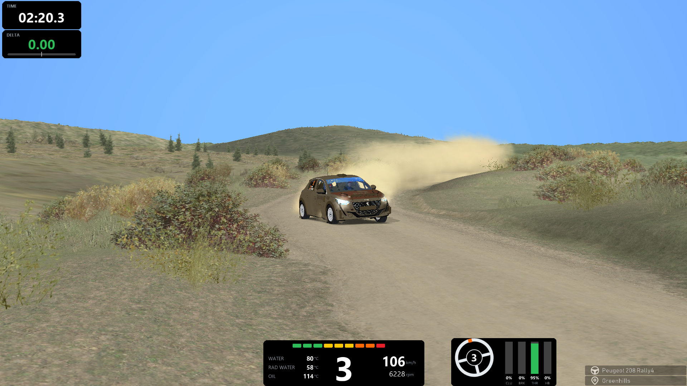

# ILLMNR-HUD

**Illuminate what matters.**  
Heads-up display for sim racing, by illuminer.

走りに必要な情報だけを、真っ黒なパネルにくっきりと表示します。
ILLMNR-HUD は、ひとつのデザインを SimHub と RBRHUD に書き出すシムレース用 HUD です。ゲームが変わっても、リプレイでも、同じ見た目で使える点がメリットです。

| 出力先 | 特徴 |
|---|---|
| **SimHub** | 対応ゲームならどれでも使える。タイヤ温度など情報が多い。サブモニターやタブレットにも出せる。**リプレイ中は動かない**（RBR） |
| **RBRHUD** | RBR 専用。ゲーム内に描画するので**リプレイでも動く**。SimHub 不要。出せる情報は RBR が用意している値だけ |

## Richard Burns Rally（RallySimFans 版）

### SimHub 版（`dist/simhub/rbr/`）

必要なものだけ選んで、好きな位置に置ける。

| ファイル | 表示 |
|---|---|
| `ILLMNR_RBR_Engine.simhubdash` | シフトライト（緑→黄→橙→赤、レッドラインで赤点滅）、ギア、速度、回転数、水温・ラジエーター水温・油温 |
| `ILLMNR_RBR_Tyres.simhubdash` | 4輪のタイヤ。色でトレッド温度（青＝冷えている、緑＝適温、赤＝熱い）。大きい数字＝トレッド温度、`C`＝カーカス温度、`A`＝タイヤ内部温度、下段＝空気圧、外側の白いバー＝タイヤの残り |
| `ILLMNR_RBR_Inputs.simhubdash` | ハンドル（中央にギア、下に切れ角）、クラッチ・ブレーキ・アクセル・サイドブレーキの踏み込み量 |
| `ILLMNR_RBR_Time.simhubdash` | ステージの経過タイム（0.1秒単位） |
| `ILLMNR_RBR_Delta.simhubdash` | ベストタイムとの差。数字は速いと緑・遅いと赤。下のバーは中央から、速いと緑が右へ・遅いと赤が左へ伸びる（10秒で端まで）。同じステージ・車でベストの記録が必要（SimHub が自動で記録） |
| `ILLMNR_RBR_Brakes.simhubdash` | 4輪のブレーキディスク温度。Tyres と同じタイル型で、色で温度（青＝冷えている、緑＝使える温度、赤＝熱すぎ）、外側の白いバー＝ディスクの残り |
| `ILLMNR_RBR_Stage.simhubdash` | ゴールまでの残り距離（km）と、ステージを何％走ったか（バー） |

**使い方**

1. [SimHub](https://www.simhubdash.com/) をインストールしておく
2. 使いたい `.simhubdash` をダウンロードし、ダブルクリックして SimHub に取り込む
3. SimHub の **Dash Studio** で取り込んだダッシュボードを選び、オーバーレイとして表示する

**ゲーム側の設定**

1. RSF Launcher の **Plugins** で `NGP` を有効にする
2. RSF Launcher の **Telemetry** で `UDP Telemetry` を有効にし、`127.0.0.1` : `6776` を入れる
3. SimHub の **Games → Richard Burns Rally → Game config** で Telemetry mode を `NGP UDP telemetry`、UDP port を `6776` にする

UDP のポートは 1 つのアプリしか使えない。ほかのアプリ（ハンコン付属ソフトなど）が 6776 を使っている場合は、
RSF Launcher の空いている行に `127.0.0.1` : `6777` を追加し、SimHub 側も `6777` にする。

### RBRHUD 版（`dist/rbrhud/`）

リプレイ中の表示（Time・Delta・Engine・Inputs）。

| エレメント | 表示 |
|---|---|
| `Custom/ILLMNR_Engine.element` | SimHub 版 Engine と同じ見た目。温度はゲームの警告で赤、シフトアップのタイミングでシフトライトが赤点滅 |
| `Custom/ILLMNR_Inputs.element` | ハンドル（実際のハンドル角で回転、中央にギア）とペダル4本 |
| `Custom/ILLMNR_Time.element` | ステージの経過タイム |
| `Custom/ILLMNR_Delta.element` | RBRHUD のデルタタイマー（F4 メニューの Delta Timers）との差。数字とバーは SimHub 版と同じ |

Tyres は RBRHUD にタイヤ温度・空気圧のデータが無いので、SimHub 版のみ。

**使い方**

1. `dist/rbrhud/ILLMNR-HUD_RBRHUD.zip` をダウンロードし、**RBR のフォルダ**（`RichardBurnsRally_SSE.exe` がある場所）に展開する
   - `Plugins/RBRHUD/OverlayElements/` の `Custom/` と `textures/` に、`ILLMNR_` で始まるファイルが追加されるだけ（既存のファイルは上書きしない）
2. ゲーム中かリプレイ中に **F4** → **Tools → Overlay Editor** を開き、表示中のオーバーレイに `Custom` → `ILLMNR_Engine` などを **Add** する
3. 位置と大きさを調整して保存する

アンインストールは、`Custom/` と `textures/` の `ILLMNR_*` を消すだけ。

## 自分で改造する

レイアウト・色・しきい値は Python で生成している。詳しくは [docs/development.md](docs/development.md)。
