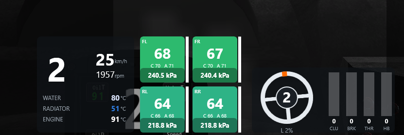

# simhub-dashboards

SimHub 用の自作オーバーレイ集。`dist/` の `.simhubdash` をダブルクリックするだけで使える。

## 使い方

1. [SimHub](https://www.simhubdash.com/) をインストールしておく
2. `dist/` から使いたい `.simhubdash` をダウンロードし、ダブルクリックして SimHub に取り込む
3. SimHub の **Dash Studio** で取り込んだダッシュボードを選び、オーバーレイとして表示する
4. 各ゲームの「ゲーム側の設定」を済ませて走る

## Richard Burns Rally（RallySimFans 版）

同じデザインで揃えてあり、必要なものだけ選んで好きな位置に置ける。

| ファイル | 表示 |
|---|---|
| `RBR_Engine.simhubdash` | シフトライト（緑→黄→橙→赤、レッドラインで赤点滅）、ギア、速度、回転数、水温・ラジエーター水温・油温 |
| `RBR_Tyres.simhubdash` | 4輪のタイヤ。色でトレッド温度（青＝冷えている、緑＝適温、赤＝熱い）。大きい数字＝トレッド温度、`C`＝カーカス温度、`A`＝タイヤ内部温度、下段＝空気圧、外側の白いバー＝タイヤの残り |
| `RBR_Inputs.simhubdash` | ハンドル（中央にギア、下に切れ角）、クラッチ・ブレーキ・アクセル・サイドブレーキの踏み込み量 |
| `RBR_Time.simhubdash` | ステージの経過タイム（0.1秒単位） |
| `RBR_Delta.simhubdash` | ベストタイムとの差。数字は速いと緑・遅いと赤。下のバーは中央から、速いと緑が右へ・遅いと赤が左へ伸びる（10秒で端まで）。同じステージ・車でベストの記録が必要（SimHub が自動で記録） |

**ゲーム側の設定**

1. RSF Launcher の **Plugins** で `NGP` を有効にする
2. RSF Launcher の **Telemetry** で `UDP Telemetry` を有効にし、`127.0.0.1` : `6776` を入れる
3. SimHub の **Games → Richard Burns Rally → Game config** で Telemetry mode を `NGP UDP telemetry`、UDP port を `6776` にする

UDP のポートは 1 つのアプリしか使えない。ほかのアプリ（ハンコン付属ソフトなど）が 6776 を使っている場合は、
RSF Launcher の 2 行目に `127.0.0.1` : `6777` を追加し、SimHub 側も `6777` にする。

## 自分で改造する

レイアウトや色の境目は Python で生成している。詳しくは [docs/development.md](docs/development.md)。
